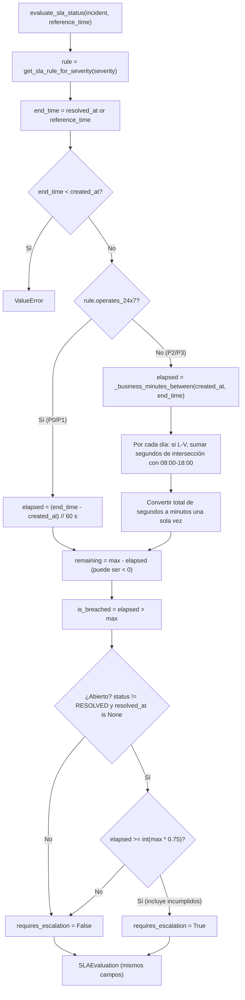

# ADR-002: Cálculo de SLA en horario hábil y escalamiento preventivo

- **Estado**: Aceptado
- **Fecha**: 2026-11-17
- **Autor(es)**: Sebastián Ortiz
- **Componentes Afectados**: `src/sla_calculator.py`

---

## 1. Contexto y Problema

La política de SLA (`SLA_POLICY_TABLE`) distingue dos regímenes de conteo:

| Severidad | `max_resolution_minutes` | `operates_24x7` | Conteo esperado |
|-----------|--------------------------|-----------------|-----------------|
| P0 | 60 | `True` | 24/7 |
| P1 | 240 | `True` | 24/7 |
| P2 | 480 | `False` | Solo L-V 08:00-18:00 (600 min/día; fines de semana = 0) |
| P3 | 1440 | `False` | Solo L-V 08:00-18:00 (600 min/día; fines de semana = 0) |

`evaluate_sla_status` ignora hoy `operates_24x7` y siempre calcula `elapsed_minutes` como la diferencia de reloj (`end_time - created_at`). Esto genera dos defectos:

1. **Cálculo de SLA incorrecto para P2/P3.** Un P2 abierto el viernes a las 18:30 y evaluado el lunes a las 08:30 da hoy **3720 min** y se marca como incumplido. El valor correcto es **30 min hábiles**.
2. **Escalamiento que se apaga tras el incumplimiento.** La condición `incident.status != "RESOLVED" and not is_breached and elapsed >= escalation_limit` deja de escalar justo cuando el incidente ya venció, que es cuando más hace falta.

**Restricciones acordadas:**
- No cambiar la firma pública de `evaluate_sla_status(incident, reference_time) -> SLAEvaluation` ni los campos de `SLAEvaluation`. El llamador en `src/incident_repository.py:146` no se modifica.
- Solo biblioteca estándar, con resultado determinista.
- `is_breached` sigue usando `>` estricto. `remaining_minutes` puede ser negativo.
- "Abierto" significa `status != "RESOLVED"` **y** `resolved_at is None`.
- Los `datetime` son *naive* y están en una sola zona horaria. Los festivos quedan **fuera de alcance**.

---

## 2. Opciones Consideradas

1. **Opción A — Iteración minuto a minuto**:
   - *Ventajas*: Muy simple de razonar. Cada minuto se clasifica como hábil o no.
   - *Desventajas*: Costo O(D×1440) en minutos recorridos. Un P3 vencido hace semanas implica decenas de miles de iteraciones por incidente, y el reporte del repositorio evalúa muchos incidentes.
2. **Opción B — Fórmula cerrada O(1)**:
   - *Ventajas*: Tiempo constante: semanas completas × 3000 más ajustes de los extremos.
   - *Desventajas*: Muchos casos especiales (inicio o fin en fin de semana, antes de 08:00 o después de 18:00, mismo día). Es frágil ante errores *off-by-one*, poco legible y difícil de extender a festivos más adelante.
3. **Opción C — Bibliotecas externas (pandas / numpy / businesstimedelta)**:
   - *Ventajas*: Lógica ya existente para calendarios hábiles.
   - *Desventajas*: Dependencias pesadas para un problema pequeño. `numpy.busday_count` cuenta **días**, no minutos, y aun así requiere ajustar a mano las fracciones de los extremos. Rompe la restricción de usar solo la stdlib.
4. **Opción D — Función pura `_business_minutes_between(start, end)` con recorrido día a día**:
   - *Ventajas*: Costo O(D) en días, solo stdlib, legible y fácil de probar de forma aislada. Extensible a festivos con un `set[date]`.
   - *Desventajas*: Más lenta que una fórmula cerrada en rangos de años (irrelevante en la práctica).

---

## 3. Decisión Arquitectónica

Se elige la **Opción D**.

**Cálculo hábil.** Se agrega la función privada y pura `_business_minutes_between(start, end) -> int`:

1. Recorre cada fecha calendario desde `start.date()` hasta `end.date()`.
2. Si el día es sábado o domingo (`weekday() >= 5`), aporta 0.
3. Si no, intersecta `[start, end]` con la ventana `[día 08:00, día 18:00)`: `max(start, apertura)` frente a `min(end, cierre)`. Si el resultado es positivo, suma los **segundos**.
4. Convierte el total a minutos **una sola vez** (`int(total_seconds // 60)`) para no acumular truncamientos por día.

**Integración en `evaluate_sla_status`.**
- `elapsed_minutes` usa el delta de reloj si `rule.operates_24x7`. Si no, usa `_business_minutes_between(created_at, end_time)`.
- `remaining_minutes = max_resolution_minutes - elapsed_minutes` (puede ser negativo).
- `is_breached = elapsed_minutes > max_resolution_minutes` (sin cambios).
- **Nueva regla de escalamiento**: `requires_escalation = abierto and elapsed_minutes >= int(max_resolution_minutes * escalation_threshold_ratio)`, con `abierto = status != "RESOLVED" and resolved_at is None`. Se elimina `not is_breached`, así que los incidentes vencidos **siguen escalados**.

---

## 4. Consecuencias e Impacto

- **Positivas**:
  - P2/P3 dejan de marcarse como incumplidos por horas nocturnas y fines de semana. El caso viernes 18:30 → lunes 08:30 pasa de 3720 a 30 min.
  - Un incidente vencido y aún abierto sigue escalado, lo que cierra el hueco operativo.
  - Solo usa la stdlib. El costo es O(D) en días, determinista, y la función pura se prueba de forma aislada.
  - El contrato público no cambia: `incident_repository.py` y los consumidores de `SLAEvaluation` no se tocan.
- **Negativas / Trade-offs**:
  - No contempla festivos ni zonas horarias. Los `datetime` *naive* se interpretan en una sola zona. Agregar festivos requerirá un parámetro o calendario adicional, en un ADR futuro.
  - Más incidentes quedarán con `requires_escalation=True` (todos los vencidos abiertos), lo que puede aumentar el volumen de alertas.
  - `remaining_minutes` negativo debe interpretarse como "minutos de exceso" en los consumidores.
- **Verificación** (pruebas unitarias deterministas):

  | Caso | Severidad | Inicio → Fin | `elapsed` esperado | Resultado clave |
  |------|-----------|--------------|--------------------|-----------------|
  | Bug reportado | P2 | vie 18:30 → lun 08:30 | 30 | `is_breached=False` |
  | Fin de semana | P2 | sáb → dom | 0 | — |
  | Cruce de fin de semana | P2 | sáb 10:00 → lun 10:00 | 120 | — |
  | Multi-semana | P3 | vie 17:00 → lunes 10 días después, 09:00 | 3120 | `is_breached=True`, `requires_escalation=True` si sigue abierto |
  | Umbral 75 % | P2 | vie 14:00 → lun 10:00 | 360 | `requires_escalation=True` (360 = int(480×0.75)) |
  | Borde apertura | P2 | lun 07:00 → lun 08:00 | 0 | — |
  | Borde cierre | P2 | lun 18:00 → lun 19:00 | 0 | — |
  | Día completo | P2 | lun 08:00 → lun 18:00 | 600 | — |
  | 24/7 sin cambio | P0/P1 | cualquier rango | delta de reloj | Regresión |
  | Resuelto | cualquiera | `resolved_at` informado | — | `requires_escalation=False` |
