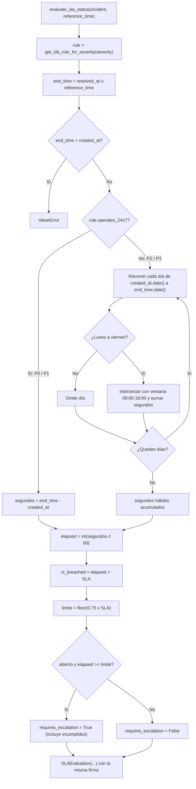

# ADR-002: Cálculo de SLA en horario hábil y escalamiento preventivo

- **Estado**: Aceptado
- **Fecha**: 2026-11-17
- **Autor(es)**: Sebastián Ortiz
- **Componentes Afectados**: `src/sla_calculator.py` (`evaluate_sla_status`, nuevo helper privado de minutos hábiles), `src/incident_repository.py` (consumidor en la línea 146, sin cambios de firma)

---

## 1. Contexto y Problema

El negocio exige que los SLA de severidad **P2** y **P3** solo consuman tiempo dentro del **horario hábil: lunes a viernes, de 08:00 a 18:00 (600 minutos por día)**. **P0** y **P1** siguen contando **24/7**. La tabla `SLA_POLICY_TABLE` ya marca esto con `operates_24x7`, pero `evaluate_sla_status` no lo usa:

```python
delta_seconds = (end_time - incident.created_at).total_seconds()
elapsed_minutes = int(delta_seconds // 60)
```

Este cálculo siempre resta tiempo de reloj 24/7, sin importar la severidad. Así salen dos defectos:

1. **Minutos transcurridos inflados (falsos incumplimientos)**. Un P2 creado el viernes a las 18:30 y evaluado el lunes a las 08:30 da **3720 minutos**, cuando el valor correcto es **30**. Como el SLA de P2 es de 480 minutos, el incidente aparece como incumplido (`is_breached=True`) aunque solo consumió 30 minutos hábiles.
2. **El escalamiento se apaga justo al vencer el SLA**. La condición actual es:
   ```python
   requires_escalation = (incident.status != "RESOLVED" and not is_breached
                          and elapsed_minutes >= escalation_limit)
   ```
   Por la cláusula `not is_breached`, un incidente abierto deja de pedir escalamiento en el momento en que incumple el SLA. Eso ocurre justo cuando más se necesita.

**Restricciones del sistema:**
- No se cambia la firma pública de `evaluate_sla_status(incident, reference_time) -> SLAEvaluation` ni la estructura de `SLAEvaluation`. Los consumidores son `src/incident_repository.py:146` y el bloque `__main__` de `src/sla_calculator.py`.
- Cero dependencias externas: solo la biblioteca estándar (`datetime`).
- Resultado determinista y complejidad **O(D)**, donde D es el número de días calendario del intervalo.
- Se mantiene la validación actual: si `end_time < created_at`, se lanza `ValueError`.

**Casos de referencia (horario hábil, P2/P3):**

| Inicio | Fin | Minutos hábiles esperados |
|---|---|---|
| vie 18:30 | lun 08:30 | 30 |
| vie 17:00 | lun 09:00 | 120 |
| sáb 10:00 | lun 12:00 | 240 |
| lun 2-nov 09:00 (P3) | lun 16-nov 09:00 | 6000 |

---

## 2. Opciones Consideradas

1. **Opción A — Iteración minuto a minuto**:
   - *Ventajas*: Es trivial de implementar y de razonar; cada minuto se clasifica como hábil o no.
   - *Desventajas*: Cuesta O(minutos). Un P3 abierto dos semanas ya son unos 20 000 pasos. No cumple el requisito O(D) y escala mal en reportes masivos desde el repositorio.
2. **Opción B — Fórmula cerrada O(1)**:
   - *Ventajas*: Tiene complejidad constante, la mejor posible en teoría.
   - *Desventajas*: Tiene muchos casos borde: inicio o fin en fin de semana, fuera de la ventana, mismo día, semanas parciales. El código resultante es difícil de leer, revisar y probar, y es fácil que tenga errores de desfase en una unidad. Una ganancia de rendimiento marginal no compensa ese riesgo.
3. **Opción C — Bibliotecas externas (pandas, businesstime, numpy)**:
   - *Ventajas*: Son funciones probadas por terceros.
   - *Desventajas*: Agregan una dependencia pesada para un cálculo pequeño, lo que rompe la restricción de cero dependencias. Además, `numpy.busday_count` cuenta días, no minutos, así que igual habría que recortar manualmente los días extremos.
4. **Opción D — Recorte día a día contra la ventana hábil (O(D), solo `datetime`)**:
   - *Ventajas*: Es legible y lineal en días. Cada día se trata igual: se intersecta `[inicio, fin]` con `[08:00, 18:00]` de ese día si es lunes a viernes. Se puede probar como función pura y no necesita dependencias.
   - *Desventajas*: Para intervalos muy largos es O(D) en lugar de O(1). Es aceptable porque D es pequeño en la práctica.

---

## 3. Decisión Arquitectónica

Se elige la **Opción D**.

**3.1 Cálculo de minutos transcurridos**

- Se agrega un helper **puro y privado** (`_business_minutes_between(start, end)`). Recorre cada día calendario entre `start.date()` y `end.date()`:
  - Si el día es sábado o domingo (`weekday() >= 5`), se omite.
  - Si es hábil, se calcula la intersección de `[start, end]` con `[día 08:00, día 18:00]` y se suman sus segundos, solo si son positivos.
- La conversión a minutos se hace **una sola vez al final** (`int(total_seconds // 60)`). Así no se acumulan truncamientos por día.
- `evaluate_sla_status` elige la estrategia según `rule.operates_24x7`:
  - `True` (P0/P1): resta de reloj 24/7, como hasta ahora.
  - `False` (P2/P3): usa el helper de horario hábil.
- La validación `end_time < incident.created_at` → `ValueError` se mantiene antes de cualquier cálculo.

**3.2 Incumplimiento y escalamiento**

- `is_breached = elapsed_minutes > rule.max_resolution_minutes` (sin cambios).
- `escalation_limit = floor(max_resolution_minutes × escalation_threshold_ratio)`. Con el ratio por defecto de 0.75 da: P0 = 45, P1 = 180, P2 = 360 y P3 = 1080.
- `requires_escalation = abierto and elapsed_minutes >= escalation_limit`, donde abierto significa `status != "RESOLVED"` y `resolved_at is None`.
  - Se **elimina** la cláusula `not is_breached`. Un incidente abierto que pasó el umbral, **incluidos los ya incumplidos**, sigue pidiendo escalamiento.
- `remaining_minutes = max_resolution_minutes - elapsed_minutes` (puede ser negativo, como hoy).
- La firma de `evaluate_sla_status` y los campos de `SLAEvaluation` no cambian.



---

## 4. Consecuencias e Impacto

- **Positivas**:
  - **Precisión**: desaparecen los falsos incumplimientos de P2/P3 causados por noches y fines de semana. El caso vie 18:30 → lun 08:30 pasa de 3720 a 30 minutos.
  - **Operación**: los incidentes abiertos e incumplidos ya no salen silenciosamente de la cola de escalamiento.
  - **Mantenibilidad**: el helper puro se prueba aislado y deja explícita la regla de la ventana hábil.
  - **Compatibilidad**: no cambia la API pública, así que `incident_repository.py:146` y `__main__` siguen funcionando sin modificaciones.
  - **Sin dependencias** y con costo O(D), que es despreciable para la duración típica de un incidente.
- **Negativas / Trade-offs**:
  - Hay un cambio de comportamiento visible: los valores de `elapsed_minutes`, `remaining_minutes` e `is_breached` de P2/P3 cambian respecto de la versión anterior. Los reportes o métricas históricas pueden no ser comparables.
  - `requires_escalation` ahora es `True` para incidentes abiertos e incumplidos. Esto puede aumentar el volumen de alertas de escalamiento.
  - **Fuera de alcance**: no se consideran **feriados** ni **zonas horarias**. Se asume que `created_at`, `resolved_at` y `reference_time` vienen en la misma zona horaria, coherente con el horario hábil. Ambos temas quedan para un ADR futuro.
  - Para intervalos muy largos el costo crece linealmente con los días (aceptado frente a la Opción B).
- **Verificación**: `uv run python -m src.sla_calculator` ejecuta casos de regresión con `assert`:
  - P2, vie 18:30 → lun 08:30 = **30**, `is_breached=False`.
  - P2, vie 17:00 → lun 09:00 = **120**.
  - P2, sáb 10:00 → lun 12:00 = **240**.
  - P3, lun 2-nov 09:00 → lun 16-nov 09:00 = **6000**, `is_breached=True` (6000 > 1440).
  - P0 en el mismo intervalo vie 17:00 → lun 09:00 sigue en 24/7 (3840).
  - Escalamiento: un incidente abierto con `elapsed == floor(0.75×SLA)` escala; uno abierto con `elapsed > SLA` escala **y** queda incumplido; uno resuelto nunca escala.
  - Bordes: inicio y fin en el mismo fin de semana dan 0 minutos.
