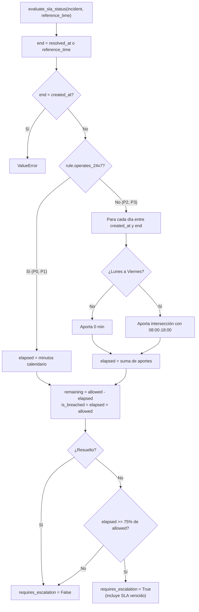
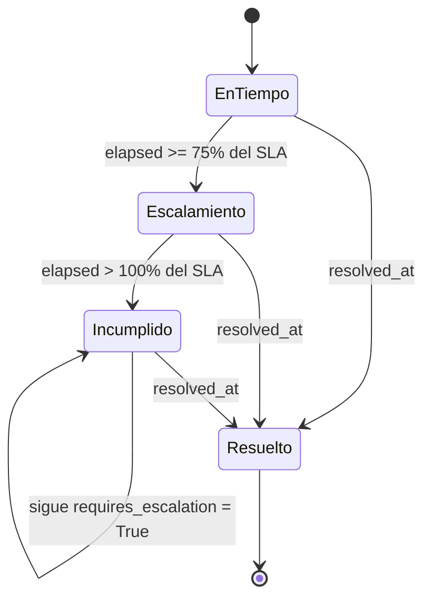

# ADR-002: Cálculo de SLA en horario hábil para P2/P3 y escalamiento preventivo

- **Estado**: Aceptado
- **Fecha**: 2026-11-17
- **Autor(es)**: Sebastián Ortiz (asistido por IA)
- **Componentes Afectados**: `src/sla_calculator.py` (`evaluate_sla_status`), consumidor `src/incident_repository.py`

---

## 1. Contexto y Problema

`evaluate_sla_status` calcula `elapsed_minutes` restando marcas de tiempo en calendario continuo (24/7) para **todas** las severidades. Según `SLA_POLICY_TABLE`, solo P0 y P1 (`operates_24x7=True`) corren todo el tiempo; P2 y P3 (`operates_24x7=False`) solo deben consumir SLA de **lunes a viernes, 08:00–18:00** (máximo 600 min por día; sábados y domingos no descuentan).

Efecto del bug: un P2 creado el viernes a las 17:00 y evaluado el lunes a las 09:00 reporta 3840 min (64 h) en vez de 120 min, y se marca como incumplido (480 min permitidos) cuando no lo está.

Además, la bandera `requires_escalation` se apagaba (`not is_breached`) justo cuando el SLA ya se había vencido, que es cuando más se necesita escalar.

Restricciones: determinismo, cero dependencias externas (solo `datetime`), código simple y legible, costo O(D) con D = días entre creación y evaluación, sin cambiar la firma pública de `evaluate_sla_status` ni `SLAEvaluation`.

Casos borde que debe cubrir:
- Creado fuera de ventana (viernes 18:30, o antes de las 08:00) → el reloj empieza en la siguiente apertura.
- Creado o evaluado en sábado/domingo → aporta 0 minutos.
- Cruce de uno o varios fines de semana.
- Creación y evaluación el mismo día, dentro de la ventana.
- Incidente resuelto → nunca requiere escalamiento.

---

## 2. Opciones Consideradas

1. **Opción A — Iteración día a día con intersección de ventanas (elegida)**:
   - *Ventajas*: simple, auditable, O(D), solo stdlib, cubre todos los casos borde con una sola regla (intersección de `[inicio, fin]` con la ventana de cada día hábil).
   - *Desventajas*: itera por día (irrelevante: D es pequeño; 1 año ≈ 365 iteraciones).
2. **Opción B — Fórmula cerrada (semanas completas × 3000 + restos)**:
   - *Ventajas*: O(1).
   - *Desventajas*: lógica de bordes (inicio/fin en fin de semana o fuera de ventana) frágil y difícil de leer; riesgo alto de errores off-by-one.
3. **Opción C — Librería externa (`numpy.busday_count`, `business-duration`, etc.)**:
   - *Ventajas*: menos código propio.
   - *Desventajas*: dependencia pesada para un cálculo trivial; no maneja minutos dentro de la ventana sin código adicional; contradice la restricción de cero dependencias.

---

## 3. Decisión Arquitectónica

Se adopta la **Opción A**. Se agrega `_business_minutes_between(start, end)`, que recorre cada día calendario entre `start` y `end`; en días lunes–viernes suma la intersección entre `[start, end]` y `[08:00, 18:00]` de ese día. `evaluate_sla_status` usa calendario continuo si `rule.operates_24x7` y horario hábil en caso contrario.

Escalamiento: para un incidente **no resuelto**, `requires_escalation = elapsed_minutes >= int(max_resolution_minutes × escalation_threshold_ratio)`. Al no excluir `is_breached`, un SLA vencido sigue escalando. Un incidente resuelto nunca escala. `is_breached` se mantiene como `elapsed_minutes > max_resolution_minutes`.

---

## 4. Consecuencias e Impacto

- **Positivas**: P2/P3 dejan de consumir SLA en noches y fines de semana; escalamiento preventivo coherente y que no se apaga al vencer; sin dependencias nuevas; algoritmo legible y testeable.
- **Negativas / Trade-offs**: no modela festivos ni zonas horarias (se asumen datetimes naive en la misma zona); la ventana 08:00–18:00 queda como constante del módulo; costo lineal en días (aceptable).
- **Verificación**: `uv run python -m src.sla_calculator` ejecuta 9 casos con minutos esperados exactos (viernes 17:00→lunes 09:00 = 120; viernes 18:30→lunes 08:30 = 30; sábado→lunes = 240; varias semanas = 6000; P0 24/7 = 3840; umbral 75 %; SLA vencido con escalamiento; resuelto sin escalamiento) mediante `assert`.
