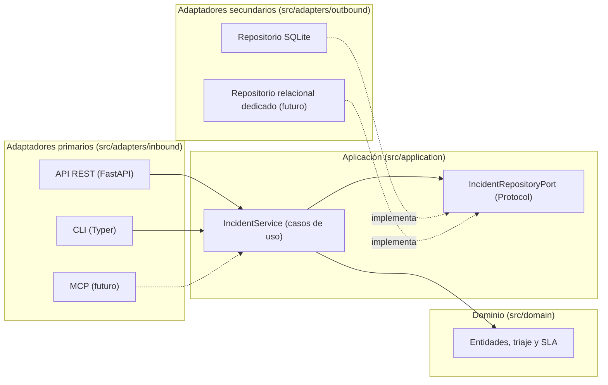

# ADR-003: Adopción de Arquitectura Hexagonal (Puertos y Adaptadores) para IncidentOps

- **Estado**: Aceptado
- **Fecha**: 2026-11-24
- **Autor(es)**: Sebastián Ortiz González
- **Reemplaza a**: —

---

## 1. Contexto y Problema

IncidentOps es hoy un conjunto de módulos planos en `src/` (triaje, SLA y un repositorio SQLite) que se ejecutan como scripts. El roadmap exige exponer las mismas reglas por **varias interfaces de entrada** (API web y terminal, y a futuro un servidor MCP para agentes) y cambiar el **motor de persistencia** (de SQLite embebido a una base relacional dedicada). La decisión estructural es **cómo se organizan las dependencias entre la lógica de negocio y la infraestructura**.

Restricciones vigentes: las reglas de triaje y SLA deben existir en un solo lugar y ser deterministas; el equipo es pequeño, así que la estructura no puede introducir frameworks de inyección de dependencias ni ORMs pesados.

---

## 2. Opciones Consideradas

1. **Opción A — Arquitectura en capas tradicional acoplada a FastAPI/SQLite**:
   - *Ventajas*: la ruta más corta a una primera API; poco código de "pegamento"; familiar para cualquier desarrollador de FastAPI.
   - *Desventajas*: la lógica de negocio termina en los *handlers* HTTP y consulta `sqlite3` directamente; la CLI tendría que duplicar esa lógica o importar código web; cambiar de motor de BD obliga a tocar el núcleo; las pruebas requieren levantar HTTP o una BD real.
2. **Opción B — Arquitectura Hexagonal (Puertos y Adaptadores)**:
   - *Ventajas*: núcleo puro (`src/domain/`) sin dependencias de infraestructura; casos de uso compartidos (`IncidentService` en `src/application/`) invocados igual por REST, CLI o un futuro MCP; puertos secundarios como `typing.Protocol` que permiten intercambiar SQLite/PostgreSQL o dobles de prueba sin cambiar el núcleo; las fronteras se pueden validar estáticamente.
   - *Desventajas*: más archivos e indirección para un sistema todavía pequeño; exige disciplina (y verificación automática) para no filtrar imports entre capas; los DTOs de cada adaptador duplican parcialmente la forma de las entidades.

---

## 3. Decisión Arquitectónica

Se adopta la **Opción B — Arquitectura Hexagonal**. El requisito de varias interfaces primarias y de motores de BD intercambiables es explícito en el roadmap; con capas acopladas, cada nueva interfaz o motor multiplicaría la lógica duplicada. Los puertos se definen con `typing.Protocol` (tipado estructural, sin herencia obligatoria) y el cableado se hace a mano en los adaptadores primarios mediante una fábrica de repositorios, sin contenedor de inyección.

Las flechas indican dirección de dependencia: todo apunta hacia el dominio; el dominio no conoce a nadie.

---

## 4. Consecuencias y Trade-offs

- **Positivas**: paridad garantizada entre interfaces (todas invocan el mismo caso de uso); el motor de persistencia se reemplaza implementando un puerto; el dominio se prueba sin HTTP ni BD; incorporar MCP no requiere tocar reglas de negocio.
- **Negativas / Trade-offs**: más estructura de carpetas y mapeos DTO ↔ entidad; las fronteras deben vigilarse con análisis estático, o se degradan silenciosamente; curva de aprendizaje para quien llega desde un estilo "FastAPI todo-en-uno".
