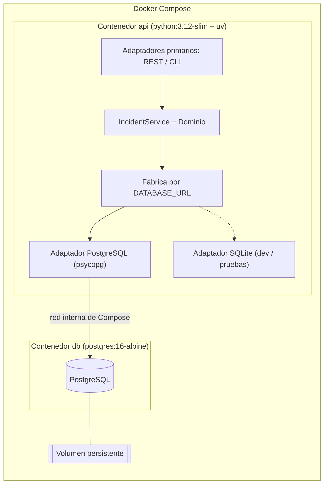

# ADR-004: Persistencia dual SQLite/PostgreSQL sin ORM ejecutada en topología multi-contenedor

- **Estado**: Aceptado
- **Fecha**: 2026-11-24
- **Autor(es)**: Sebastián Ortiz González
- **Reemplaza a**: `ADR-001`, **parcialmente**: se levanta la restricción de "solo `sqlite3` de la biblioteca estándar, sin dependencias externas" para producción; SQLite embebido se mantiene para desarrollo local y pruebas.

---

## 1. Contexto y Problema

El equipo de Plataforma necesita ejecutar IncidentOps en contenedores junto a una base de datos relacional dedicada y con un chequeo real de conectividad. Hoy la persistencia es SQLite embebido (ADR-001): un archivo local con un único escritor, que no sobrevive bien a réplicas del servicio ni separa el ciclo de vida de los datos del de la aplicación.

La decisión estructural es **qué motor de persistencia usa el servicio en producción y en qué topología de ejecución se despliega**. Ambas cosas se deciden juntas porque el motor dedicado solo tiene sentido si existe un runtime que lo orqueste.

Fuerzas y restricciones vigentes:
- Arquitectura Hexagonal (ADR-003): el cambio debe quedar confinado a un adaptador secundario que implemente `IncidentRepositoryPort`; dominio, casos de uso y adaptadores primarios no se tocan.
- Constitución: SQL explícito sin ORM; las pruebas deben seguir siendo rápidas y ejecutables sin infraestructura.
- El cálculo de SLA compara marcas de tiempo; ambos motores deben devolver exactamente los mismos instantes.

---

## 2. Opciones Consideradas

1. **Opción A — Mantener solo SQLite, empaquetado en un contenedor con volumen**:
   - *Ventajas*: cero dependencias nuevas; un solo contenedor; ADR-001 intacto; las pruebas no cambian.
   - *Desventajas*: sigue siendo un único escritor y un archivo atado al contenedor de la aplicación; no hay una "base de datos dedicada" que operar, respaldar o monitorear de forma independiente; impide escalar horizontalmente la API.
2. **Opción B — Persistencia dual SQLite/PostgreSQL sin ORM (`psycopg[binary]`), elegida por `DATABASE_URL`, en Docker Compose con dos contenedores (`api` + `db` `postgres:16-alpine`)**:
   - *Ventajas*: PostgreSQL aporta concurrencia real y un ciclo de vida de datos independiente (volumen propio, `pg_isready`); SQLite sigue sirviendo para desarrollo y pruebas en milisegundos; el SQL explícito mantiene el control de índices y consultas; el cambio cabe en un adaptador gracias a ADR-003.
   - *Desventajas*: dos adaptadores que mantener en paridad (dialectos `?` vs `%s`, `INSERT OR REPLACE` vs `ON CONFLICT`); dependencia binaria nueva; las pruebas rápidas no ejercitan PostgreSQL real.
3. **Opción C — PostgreSQL a través de un ORM multi-motor (SQLAlchemy) en la misma topología**:
   - *Ventajas*: un único modelo de mapeo para ambos motores; migraciones gestionadas (Alembic); menos SQL duplicado.
   - *Desventajas*: contradice el principio "sin ORM" de la Constitución; añade una capa de abstracción y dependencias pesadas para un modelo de una tabla; oculta las consultas que el proyecto optimizó a mano (índices compuestos, eliminación del N+1).

---

## 3. Decisión Arquitectónica

Se adopta la **Opción B**. Es la única que satisface a la vez la necesidad de una base de datos dedicada (descarta A) y la regla de SQL explícito sin ORM (descarta C). La duplicación de SQL entre dialectos es acotada (una tabla, cinco operaciones) y queda vigilada porque ambos adaptadores deben cumplir el mismo puerto.

Dos reglas estructurales acompañan la decisión:
- **Selección por configuración**: una fábrica elige el adaptador según el esquema de `DATABASE_URL` (`postgresql://` → PostgreSQL; `sqlite:///` o ausencia → SQLite en memoria). Ningún otro componente conoce el motor.
- **Paridad temporal**: las marcas de tiempo se almacenan en ambos motores como texto ISO 8601 en hora local de operación (`TEXT`, no `TIMESTAMPTZ`), para que los dos motores devuelvan instantes idénticos y el cálculo de SLA no dependa del motor ni de la zona horaria de la sesión.

---

## 4. Consecuencias y Trade-offs

- **Positivas**: los datos viven en un servicio dedicado con su propio volumen y chequeo de salud; la API puede reiniciarse o replicarse sin perder datos; el núcleo hexagonal no cambia; el desarrollo local y la suite de pruebas siguen sin requerir Docker.
- **Negativas / Trade-offs**: se mantienen dos dialectos SQL en paralelo y una dependencia binaria nueva; las pruebas rápidas validan el contrato del puerto pero no la semántica real de PostgreSQL, por lo que se requiere verificación en contenedores; guardar fechas como `TEXT` renuncia a funciones temporales nativas de PostgreSQL a cambio de paridad entre motores; operar Compose (volúmenes, credenciales, orden de arranque) es un costo operativo nuevo.
